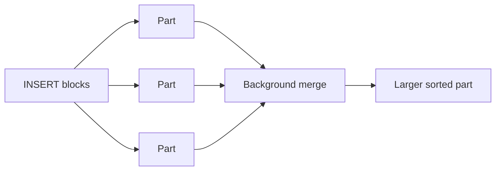
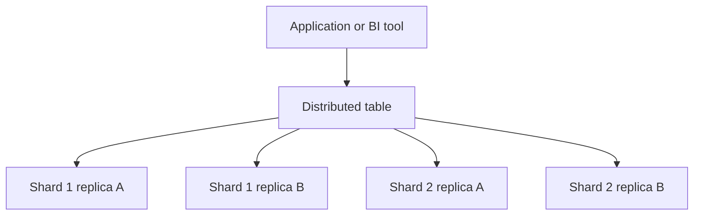

# ⚡ Explain Me: ClickHouse

> **ClickHouse** is an open-source, column-oriented database built for analytical queries. It scans and aggregates very large tables quickly, and it is aimed at OLAP workloads rather than transactional row updates.

---

## 📚 1. Concept in Detail

### What it is good at

ClickHouse stores each column separately, compresses it, and only reads the columns a query needs. Aggregations such as `count`, `sum`, and `uniq` over billions of rows are the core job. Typical uses are product analytics, observability, clickstreams, and real-time dashboards.

It is a poor fit for workloads that update or delete individual rows all day. Updates exist, but they are asynchronous mutations or special table engines, not OLTP transactions.

### 🔑 Related concepts

| Concept | Meaning |
|---------|---------|
| **Columnar storage** | Values of one column sit together, which speeds scans and compression |
| **MergeTree** | The main table engine. Inserts create immutable parts; background merges combine them |
| **ORDER BY / primary key** | The sort key inside parts. It is not a uniqueness constraint. It speeds filters that match the prefix |
| **Partition key** | Splits data into directories (often by month). Helps TTL and dropping old data |
| **PART** | An immutable chunk of rows created by an insert. Too many small parts hurt performance |
| **ReplacingMergeTree** | Collapses rows with the same sort key during merges. Dedup is not instant |
| **SummingMergeTree / AggregatingMergeTree** | Pre-aggregate rows with the same key as parts merge |
| **Materialized view** | A trigger-like insert into another table as data arrives |
| **Sharding** | Split data across nodes. A `Distributed` table queries them as one |
| **Replication** | Copies of a shard via ClickHouse Keeper (or ZooKeeper) |
| **Sparse primary index** | Index marks every N rows (granules), not every row |
| **Granule** | Default block of 8192 rows between index marks |
| **TTL** | Drops or moves old rows automatically |
| **LowCardinality** | Dictionary encoding for columns with few distinct strings |
| **Projection** | An alternate sort of the same data for a different filter pattern |

### Insert and merge lifecycle



Batch inserts. A stream of single-row inserts creates a storm of parts.

### Cluster shape



### ClickHouse vs a transactional database

| | ClickHouse | PostgreSQL |
|--|------------|------------|
| Storage | Columns | Rows |
| Best query | Large scans and aggregates | Point lookups and transactions |
| Updates | Mutations, eventual | Immediate, ACID |
| Indexes | Sparse sort key | B-tree and others |
| Joins | Supported, but star-schema aggregates are the sweet spot | General purpose |

---

## 🛠️ 2. How to Implement

### Run it locally

```bash
docker run -d --name clickhouse -p 8123:8123 -p 9000:9000 clickhouse/clickhouse-server
docker exec -it clickhouse clickhouse-client
```

Port `8123` is HTTP. Port `9000` is the native protocol.

### Create an events table

```sql
CREATE TABLE events
(
    event_date Date,
    event_time DateTime,
    user_id UInt64,
    event_name LowCardinality(String),
    country LowCardinality(String),
    revenue Decimal(12, 2)
)
ENGINE = MergeTree
PARTITION BY toYYYYMM(event_date)
ORDER BY (event_name, country, user_id)
TTL event_date + INTERVAL 180 DAY;
```

`ORDER BY` should start with columns you filter on most often.

### Insert in batches

```sql
INSERT INTO events
SELECT
    today() AS event_date,
    now() AS event_time,
    number AS user_id,
    ['view', 'click', 'purchase'][number % 3 + 1] AS event_name,
    ['US', 'IN', 'DE'][number % 3 + 1] AS country,
    (number % 50) / 2 AS revenue
FROM numbers(1000000);
```

### Query

```sql
SELECT
    country,
    count() AS events,
    uniq(user_id) AS users,
    sum(revenue) AS revenue
FROM events
WHERE event_date >= today() - 7
  AND event_name = 'purchase'
GROUP BY country
ORDER BY revenue DESC;
```

`uniq` is an approximate unique count (HyperLogLog). Use `uniqExact` only when you truly need an exact number.

### Python client

```python
import clickhouse_connect

client = clickhouse_connect.get_client(host="localhost", port=8123)

client.insert(
    "events",
    [["2026-10-30", "2026-10-30 10:00:00", 42, "click", "IN", "0.00"]],
    column_names=["event_date", "event_time", "user_id", "event_name", "country", "revenue"],
)

rows = client.query(
    """
    SELECT event_name, count() AS n
    FROM events
    WHERE event_date = {day:Date}
    GROUP BY event_name
    """,
    parameters={"day": "2026-10-30"},
)
print(rows.result_rows)
```

### A materialized view for rollups

```sql
CREATE TABLE events_daily
(
    event_date Date,
    event_name LowCardinality(String),
    events AggregateFunction(count),
    users AggregateFunction(uniq, UInt64)
)
ENGINE = AggregatingMergeTree
ORDER BY (event_date, event_name);

CREATE MATERIALIZED VIEW events_daily_mv TO events_daily AS
SELECT
    event_date,
    event_name,
    countState() AS events,
    uniqState(user_id) AS users
FROM events
GROUP BY event_date, event_name;

SELECT
    event_date,
    event_name,
    countMerge(events) AS events,
    uniqMerge(users) AS users
FROM events_daily
GROUP BY event_date, event_name;
```

### Deduplicating late updates

```sql
CREATE TABLE users
(
    user_id UInt64,
    email String,
    updated_at DateTime
)
ENGINE = ReplacingMergeTree(updated_at)
ORDER BY user_id;

-- Force collapse for a correct point read
SELECT user_id, argMax(email, updated_at)
FROM users
GROUP BY user_id;
```

`FINAL` also collapses duplicates at read time, at a cost. Prefer `argMax` in aggregates.

---

## 💡 3. Examples

### Example: Why column storage wins

A query that sums `revenue` and groups by `country` reads those two columns plus the filter columns. It does not read `user_id` or unused properties. A row store would pull every field of every matching row.

### Example: Sort key design

| Query pattern | Better ORDER BY prefix |
|---------------|------------------------|
| Always filter `event_name`, then `country` | `(event_name, country, …)` |
| Always filter a tenant, then time | `(tenant_id, event_date, …)` |
| Look up one user | Not ClickHouse’s strongest shape; still possible with `user_id` early in the key |

### Example: Avoid a part explosion

```sql
-- See parts per table
SELECT table, count() AS parts, sum(rows) AS rows
FROM system.parts
WHERE active AND database = currentDatabase()
GROUP BY table
ORDER BY parts DESC;
```

If `parts` stays in the thousands, inserts are too small or merges cannot keep up.

---

## ✅ 4. Advantages and Requirements

### Advantages

| Advantage | Detail |
|-----------|--------|
| ⚡ Fast aggregates | Column scans, vectorized execution, and compression |
| 📥 High ingest | Batch inserts land as parts and become queryable quickly |
| 💰 Compression | Columns often shrink far below raw JSON or CSV |
| 🔓 Open source | Apache 2.0 server you can run yourself |
| 🧮 SQL | Familiar syntax plus array, approximate, and time functions |
| ⏱️ TTL | Old partitions can expire without a manual cleanup job |

### Requirements

- Linux servers or containers. macOS and Windows are for development, not the usual production target.
- Fast local disks (NVMe). ClickHouse is sensitive to disk latency during merges.
- RAM for the working set and for merges. A common starting point is to keep heavy `GROUP BY` state in memory.
- Batched inserts (thousands of rows, or async inserts) rather than one row per request.
- A sort key designed from real `WHERE` clauses.
- ClickHouse Keeper if you replicate.
- Operators who understand parts, merges, and mutations. `ALTER TABLE … UPDATE` rewrites data in the background.
- Clients: `clickhouse-client`, HTTP, or `clickhouse-connect` (`pip install clickhouse-connect`).

### When not to use it

- Frequent single-row updates with read-your-writes guarantees.
- Many small transactional joins as the main workload.
- A primary key that must reject duplicates on insert. MergeTree will not do that by itself.

---

## 🔗 Quick Reference

| Item | Value |
|------|--------|
| Site | https://clickhouse.com |
| HTTP port | 8123 |
| Native port | 9000 |
| Main engine | `MergeTree` |
| Docs | https://clickhouse.com/docs |
