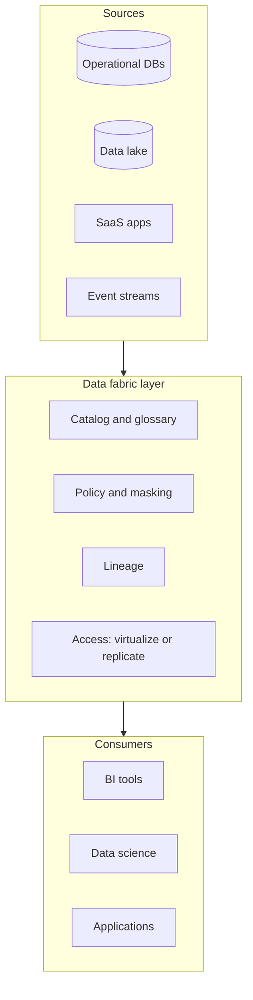
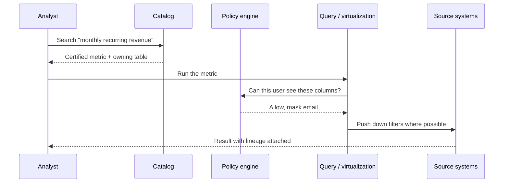
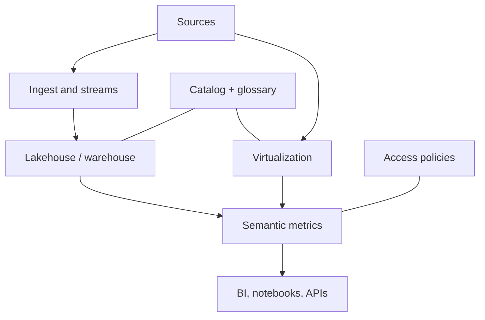

### 🧵 What is **Data Fabric**?


> A **data fabric** is an architecture that connects data across systems and presents it through a shared layer of discovery, governance, and access. Consumers ask for data in one place instead of learning every source system.

---

## 📚 1. Concept in Detail

### The problem it addresses

Most organizations already have a warehouse, a lake, operational databases, SaaS apps, and event streams. Each has its own catalog, permissions, and definitions of “customer” or “revenue.” Analysts spend their time finding the right table and hoping the join is allowed.

A data fabric does not require you to copy every dataset into one database first. It adds a layer that can:

- **Find** datasets (catalog and search)
- **Understand** them (metadata, lineage, business terms)
- **Govern** them (who can see which columns)
- **Deliver** them (query in place, or replicate when a copy is justified)

“In place” access is the point that separates a fabric from “put everything in the warehouse.”

### 🔑 Related concepts

| Concept | Meaning |
|---------|---------|
| **Data catalog** | An inventory of tables, files, topics, and dashboards, with owners and descriptions |
| **Metadata** | Technical (schema, location) and business (definition of revenue, PII flags) |
| **Active metadata** | Metadata that is refreshed from real usage, quality checks, and lineage — not a wiki nobody updates |
| **Data virtualization** | A query engine that federates SQL across sources without always landing a copy |
| **Semantic layer** | Shared metrics and entities (`revenue`, `active user`) so every tool does not redefine them |
| **Lineage** | Where a column came from and which dashboards depend on it |
| **Data product** | A curated, owned, documented dataset with an SLO, not a raw dump |
| **Policy / governance** | Access rules, masking, retention, and purpose limits applied across tools |
| **Knowledge graph** | Relationships among datasets, terms, owners, and systems, used to recommend and resolve meaning |
| **ETL / ELT** | Still used inside a fabric when performance, history, or source load requires a copy |
| **Data mesh** | An operating model: domain teams own products. A fabric is a technology approach. They can coexist |

### Fabric vs neighboring ideas



| Approach | Central idea |
|----------|----------------|
| **Data warehouse** | Copy curated data into one SQL store for analytics |
| **Data lake** | Land raw files cheaply; transform later |
| **Lakehouse** | Warehouse-style tables on lake storage (Iceberg, Delta, Hudi) |
| **Data mesh** | Domains own data products; platform team provides standards |
| **Data fabric** | Connect and govern distributed data with shared metadata and access |

A fabric often **includes** a warehouse or lakehouse. It is the connecting layer, not a single product you install and finish.

### How a question moves through it



---

## 🛠️ 2. How to Implement

A fabric is a program of work, not a library call. A practical sequence:

### 1. Inventory and classify

List systems, owners, and which datasets people actually use. Tag PII and criticality. Start with the ten datasets that feed executive reports, not every table in every database.

### 2. Stand up a catalog

Minimum fields for every published dataset:

| Field | Example |
|-------|---------|
| Name and location | `warehouse.billing.subscriptions` |
| Owner | Billing domain |
| Description | One row per subscription, updated nightly |
| Classification | Contains customer id; no card numbers |
| Freshness | Daily by 06:00 UTC |
| Quality checks | Primary key unique, no negative MRR |

Open source building blocks include DataHub and OpenMetadata. Cloud catalogs include Dataplex, Microsoft Purview, and AWS Glue Data Catalog. A warehouse’s `INFORMATION_SCHEMA` is an input to the catalog, not a substitute for business context.

### 3. Define a semantic layer

Put metric logic in one place:

```yaml
# Example metric definition (semantic layer style)
metric: monthly_recurring_revenue
description: Sum of active subscription value, normalized to a month
owner: billing
expr: sum(plan_amount) where status = 'active'
time_grain: month
filters_allowed: [region, plan]
```

Tools in this space include dbt Semantic Layer, Cube, LookML, and MetricFlow. The format varies; the rule does not: one definition of MRR.

### 4. Enforce policy at access time

```text
Role analyst_region_in:
  allow select on billing.subscriptions
  mask email
  row filter region = 'IN'
```

Apply the same policy whether the person uses SQL, a BI tool, or a notebook. If each tool reinvents access checks, you do not have a fabric.

### 5. Choose delivery per dataset

| Situation | Delivery |
|-----------|----------|
| Source is fast, query is selective, data must be current | Virtualize / federate |
| Scan is heavy or the source cannot take analytical load | Replicate into the warehouse or lakehouse |
| Many consumers share a curated join | Publish a data product table |
| Event-shaped facts | Stream into the analytical store |

### 6. Capture lineage from pipelines

```python
# Sketch: emit lineage when a job finishes
lineage.emit(
    inputs=["crm.accounts", "billing.subscriptions"],
    output="analytics.customer_360",
    job="nightly_customer_360",
    owner="growth-platform",
)
```

Lineage should come from the orchestrator (Airflow, Dagster, dbt) automatically. Hand-drawn diagrams go stale.

### Reference shape



---

## 💡 3. Examples

### Example: One customer question, three systems

“Which enterprise accounts in India expanded this quarter?”

Without a fabric, an analyst hunts CRM for accounts, billing for invoices, and the product database for usage, then negotiates access to each.

With a fabric:

1. The catalog resolves **enterprise account** to a certified data product.
2. Policy allows this analyst to see India rows and masks phone numbers.
3. The semantic layer computes **expansion** as an increase in MRR, so a second dashboard cannot define it differently.
4. Lineage shows the product is built from CRM and billing, refreshed nightly. The analyst knows not to expect intraday numbers.

### Example: Virtualize vs copy

| Dataset | Choice | Reason |
|---------|--------|--------|
| Today’s inventory counts | Query the operational replica | Must be fresh; table is small |
| Five years of click events | Copy to a columnar store | Source cannot scan years of logs |
| HR compensation | Copy plus strict policy | Sensitive, few consumers, audited |

### Example: What “done” looks like for one domain

- Owner named.
- Tables documented and classified.
- Nightly freshness check pages someone when it fails.
- MRR defined once.
- A new analyst can find the dataset from search without asking in chat.

---

## ✅ 4. Advantages and Requirements

### Advantages

| Advantage | Detail |
|-----------|--------|
| 🔎 Faster discovery | Search replaces tribal knowledge |
| 🧭 Consistent metrics | A semantic layer stops conflicting dashboards |
| 🔐 Consistent control | Masking and row filters follow the data |
| 🗺️ Impact analysis | Lineage shows what breaks if a column changes |
| ⚖️ Less unnecessary copying | Hot, small, or restricted data can stay put |
| 🤝 Clear ownership | Data products have a team, not an anonymous schema |

### Requirements

- Executive backing to name owners. A catalog with no owners becomes a second unread wiki.
- An inventory of real sources and the access paths to them.
- A catalog, a policy engine, and a curated analytical store. Virtualization alone will not carry heavy history.
- Pipeline tooling that emits lineage (dbt, orchestrators, or catalog collectors).
- A small set of certified data products before a attempt to onboard every table.
- Identity integration (SSO groups) so policies map to real teams.
- Skills across data engineering, governance, and domain experts who define terms.
- Patience for organizational change. Buying a catalog product does not create a fabric.

### Limits

Federation pushes load back to source systems. A fabric that virtualizes everything will slow operational databases. Governance theater — tags nobody maintains — is worse than a smaller, accurate catalog. Data mesh and data fabric solve different layers; renaming a warehouse “fabric” does not connect SaaS apps or apply shared policy.

---

## 🔗 Quick Reference

| Piece | Role |
|-------|------|
| Catalog | Find and describe data |
| Glossary / semantic layer | Agree what metrics mean |
| Policy | Decide who sees what |
| Lineage | Show where data came from |
| Warehouse or lakehouse | Hold what should be copied |
| Virtualization | Query what should stay in place |
