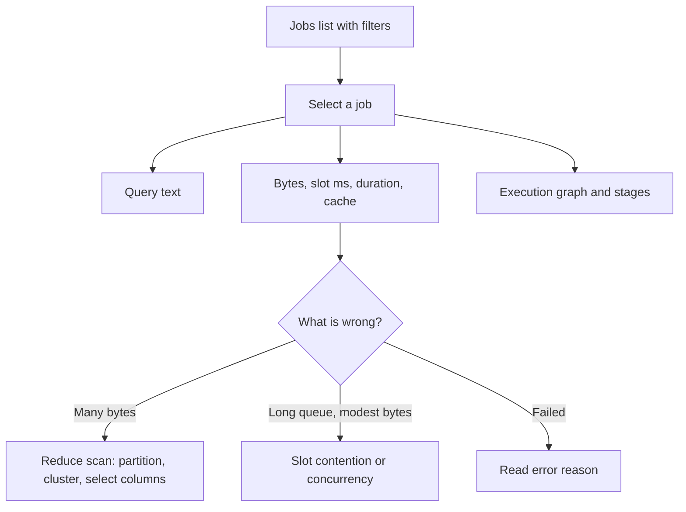
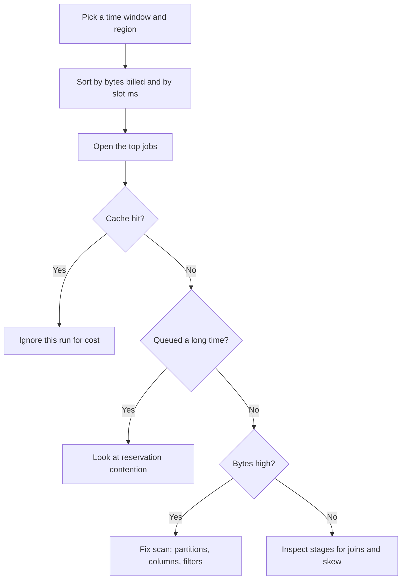

# 🔎 Explain Me: BigQuery Jobs Explorer

> **Jobs Explorer** is the BigQuery page where you inspect query and load jobs: who ran them, how long they took, how many bytes they scanned, and how many slots they used. It is the first place to look when a query is slow, expensive, or failing.


---

## 📚 1. Concept in Detail

### What a job is

Every time BigQuery runs work for you, it creates a **job**. A job has an id, an owner, a location, a state, and statistics. Interactive queries from the console, scheduled queries, `bq` CLI commands, and API clients all show up as jobs.

| Job type | What it does |
|----------|----------------|
| **QUERY** | `SELECT`, DML, DDL, scripting |
| **LOAD** | File or storage load into a table |
| **EXTRACT** | Export a table to files |
| **COPY** | Copy a table |

Jobs Explorer is built to **list and filter** these records. Opening one job shows the SQL, the execution graph, and the bytes and slot time that explain cost and speed.

### 🔑 Fields that matter

| Field | Why you look at it |
|-------|--------------------|
| **Job ID** | Unique id. Support and logs use it. Prefix often hints at the client (`scheduled_query_`, `bquxjob_`, Airflow, dbt). |
| **User** | The identity that ran the job: a person or a service account. |
| **State** | `PENDING` (queued), `RUNNING`, `DONE`. |
| **Duration** | Wall-clock time from start to end. Includes waiting on slots if the timer starts late — compare with creation time. |
| **Slot time** (`total_slot_ms`) | How much compute the job consumed. High slot time means heavy work. |
| **Bytes processed / billed** | On-demand cost driver. Cached results bill zero bytes. |
| **Cache hit** | The result was reused. Fast and free, but not a sign the SQL is cheap next time. |
| **Reservation** | Which slot pool ran the job, if you use capacity pricing. |
| **Error** | Reason and message when the job failed. |
| **Stages / timeline** | Where time went: wait, read, shuffle, write. |

### How the page is organized



The list is a table of recent jobs. Filters sit above it: project, location, user, time range, and often duration or bytes. Green and red status marks tell you which jobs finished and which failed. Select a row to open details.


### Related places in BigQuery

| Surface | Use it for |
|---------|------------|
| **Jobs Explorer** | Interactive hunting across recent jobs |
| **Job details** | One job’s SQL, plan, and stats |
| **INFORMATION_SCHEMA.JOBS_BY_PROJECT** | SQL over job history for trends and alerts |
| **Query history** in the editor | Your own recent SQL in this browser |
| **Capacity management** | Reservations and slot usage over time |

Personal query history is not enough when a service account or a teammate ran the expensive job. Jobs Explorer, with `jobs.listAll`, shows those too.

---

## 🛠️ 2. How to Use and Analyze It

### Open it

1. In Google Cloud Console go to **BigQuery**.
2. Open **Jobs explorer** (under the job history / monitoring area; the label in the UI is “Jobs explorer”).
3. Set **location** to the region where the query ran (`us`, `eu`, `asia-south1`, …). A job in `us` will not appear if you are looking at another region.
4. Set the time range. Start with the last few hours when you are chasing an incident, or 7 days when you are looking for expensive patterns.

You need permission to list jobs:

| Permission | What you see |
|------------|----------------|
| `bigquery.jobs.list` | Jobs you created |
| `bigquery.jobs.listAll` | Jobs created by others in the project, including service accounts |
| `bigquery.jobs.get` | Details of a job |

Project **Owner**, **BigQuery Admin**, and **BigQuery Resource Admin** can list all jobs. Analysts often need an extra role if service-account jobs are invisible.

### Filter with a purpose

| You want | Filter |
|----------|--------|
| One person’s complaints | User email |
| A pipeline | Service account email, or job id prefix |
| Failures only | State = failed, or sort and scan the status column |
| Slow jobs | Minimum duration, or sort by duration |
| Expensive on-demand jobs | Sort by bytes processed |
| Heavy compute | Sort by slot time |

### Read a single job


On the details page, read in this order:

1. **Status and error.** If it failed, the reason is the answer. Common ones: `resourcesExceeded`, `accessDenied`, `notFound`, syntax errors, and quota.
2. **Bytes processed and bytes billed.** This is the on-demand bill. A sudden jump usually means a missing partition filter or a `SELECT *` on a wide table.
3. **Slot milliseconds and duration.** Divide slot-ms by duration-ms to estimate average slots. A long duration with a modest average means the job waited or ran with few slots.
4. **Cache.** `cacheHit: true` means this run did not scan. Do not use that run to judge SQL cost.
5. **Timeline.** A long bar before useful work is queue or scheduling. A long read stage is scan volume. A long shuffle on a join is data movement between stages.
6. **SQL text.** Confirm the partition filter is a real date predicate BigQuery can prune, not wrapped in a function that blocks pruning.

### Analyze a set of jobs


Use the list for three questions:

1. **What is slow?** Filter to duration above your SLO (for example 30 seconds) and see whether the same user or report name repeats.
2. **What is heavy?** Sort by slot time. The top few jobs often dominate a reservation.
3. **What is repeated?** Identical SQL from a dashboard every minute is a candidate for caching, BI Engine, a materialized table, or a longer refresh interval.

For anything beyond a quick look, use SQL so you can group and chart.

```sql
SELECT
  job_id,
  user_email,
  statement_type,
  creation_time,
  TIMESTAMP_DIFF(start_time, creation_time, SECOND) AS queued_s,
  TIMESTAMP_DIFF(end_time, COALESCE(start_time, end_time), SECOND) AS ran_s,
  total_slot_ms,
  ROUND(total_bytes_billed / POW(1024, 3), 2) AS gb_billed,
  cache_hit,
  reservation_id,
  error_result.reason AS error_reason,
  SUBSTR(query, 1, 120) AS query_preview
FROM `region-us`.INFORMATION_SCHEMA.JOBS_BY_PROJECT
WHERE creation_time > TIMESTAMP_SUB(CURRENT_TIMESTAMP(), INTERVAL 1 DAY)
  AND job_type = 'QUERY'
ORDER BY total_slot_ms DESC
LIMIT 30;
```

Change `region-us` to your region. Bytes billed are the on-demand cost base. Slot-ms is the compute-usage base for capacity pricing.

### A simple analysis loop



---

## 💡 3. Examples

### Example: “The dashboard is slow”

1. Filter Jobs Explorer to the BI service account and the last 2 hours.
2. Open a slow job. Duration is 90 seconds. Bytes billed are 2 GB. Queue time is 70 seconds.
3. Slot time is modest. The SQL is fine; the job waited.
4. Next step is reservation load at that minute, not a rewrite of the SQL. See the slots note.

### Example: “Yesterday’s bill jumped”

```sql
SELECT
  user_email,
  ROUND(SUM(total_bytes_billed) / POW(1024, 4), 2) AS tib_billed,
  COUNT(*) AS jobs
FROM `region-us`.INFORMATION_SCHEMA.JOBS_BY_PROJECT
WHERE creation_time > TIMESTAMP_SUB(CURRENT_TIMESTAMP(), INTERVAL 2 DAY)
  AND job_type = 'QUERY'
  AND cache_hit IS NOT TRUE
GROUP BY user_email
ORDER BY tib_billed DESC;
```

Then open the top user’s largest job in Jobs Explorer and read the `WHERE` clause. A missing `event_date` filter on a partitioned table is a frequent cause.

### Example: Failure you can see immediately

| Error reason | Typical meaning | What to do |
|--------------|-----------------|------------|
| `accessDenied` | The runner cannot read a table | Grant the service account access |
| `notFound` | Dataset, table, or region mismatch | Check the name and the job location |
| `resourcesExceeded` | A stage needed more memory or shuffle than allowed | Filter earlier, split the query, or reduce skew |
| `quotaExceeded` | Project or user quota | Smooth the schedule or raise quota |
| `stopped` | Someone cancelled it | Confirm it was intentional |

### Example: Execution timeline in words

| Stage bar | Interpretation |
|-----------|----------------|
| Long wait, short compute | Slot contention or concurrency cap |
| Long read, many bytes | Large scan; check partition pruning |
| Long join / shuffle | Keys are skewed or the join is huge |
| Almost instant, 0 bytes | Cache hit or a metadata-only statement |

---

## ✅ 4. Advantages and Requirements

### Advantages

| Advantage | Detail |
|-----------|--------|
| 👀 One list for every client | Console, API, dbt, Airflow, and scheduled queries land in the same place |
| 💵 Cost clues | Bytes billed point at on-demand spend without a billing export |
| ⏱️ Speed clues | Duration, queue gap, and slot-ms separate “slow SQL” from “no slots” |
| 🐛 Fast failure triage | The error reason is on the job, next to the SQL that failed |
| 🔁 Repeatable audits | The same facts are in `INFORMATION_SCHEMA` for weekly reviews |

### Requirements

- A Google Cloud project with BigQuery jobs in a known **region**.
- IAM: `bigquery.jobs.list` at minimum; `bigquery.jobs.listAll` to analyze other users and service accounts.
- Job details permission: `bigquery.jobs.get`.
- A time window. Explorer is for recent operational history, not a multi-year warehouse of jobs. Export `INFORMATION_SCHEMA` results if you need longer retention.
- Careful handling of SQL text. Job records can contain literals from queries. Restrict who can view them if queries include sensitive constants.

### Limits

- Illustrations in this note are teaching pictures. Labels in the live console move as Google updates the UI.
- Bytes processed are not the full story on Editions / slot pricing. Pair them with slot-ms and the reservation.
- A cached job understates cost. Always check `cache_hit` before you celebrate a cheap run.

---

## 🔗 Quick Reference

| Item | Value |
|------|--------|
| Console | BigQuery → Jobs explorer |
| SQL history | ``region-REGION.INFORMATION_SCHEMA.JOBS_BY_PROJECT`` |
| List all jobs | `bigquery.jobs.listAll` |
| Cost signal | `total_bytes_billed` |
| Compute signal | `total_slot_ms` |
| Queue signal | `start_time - creation_time` |
