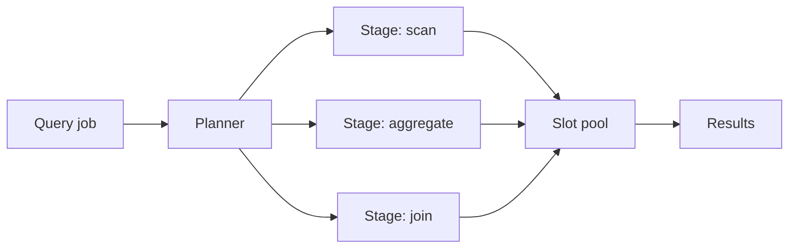
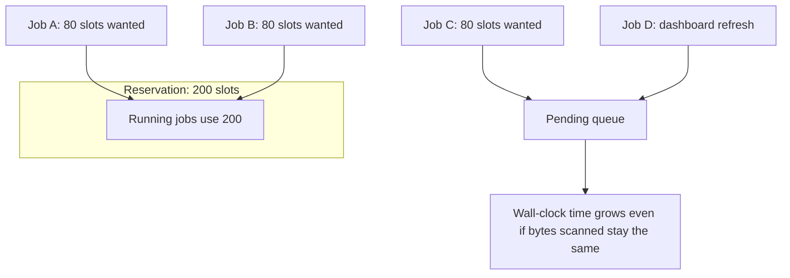
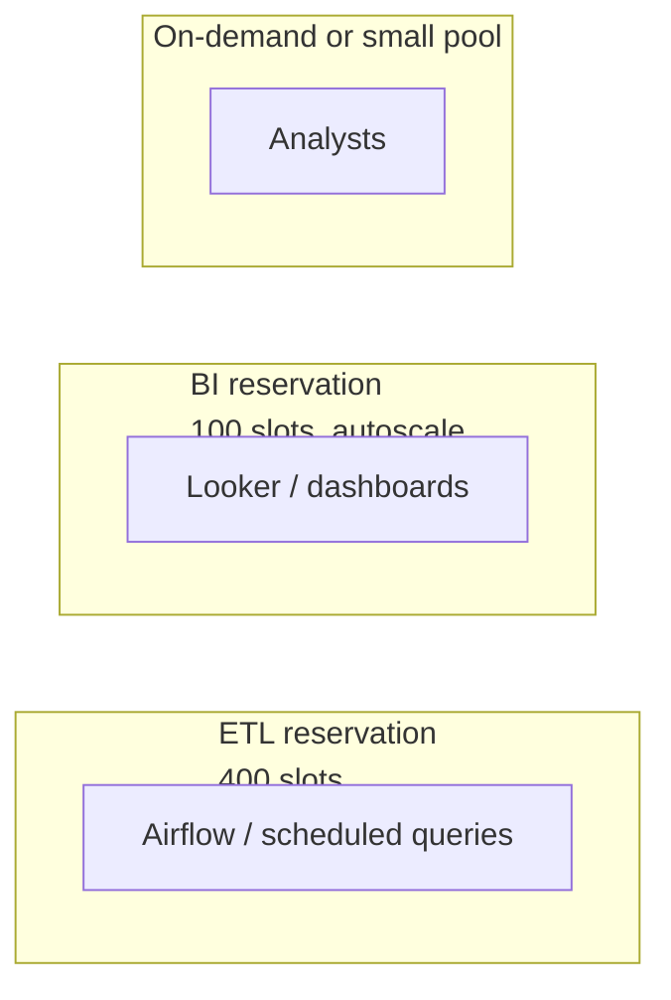
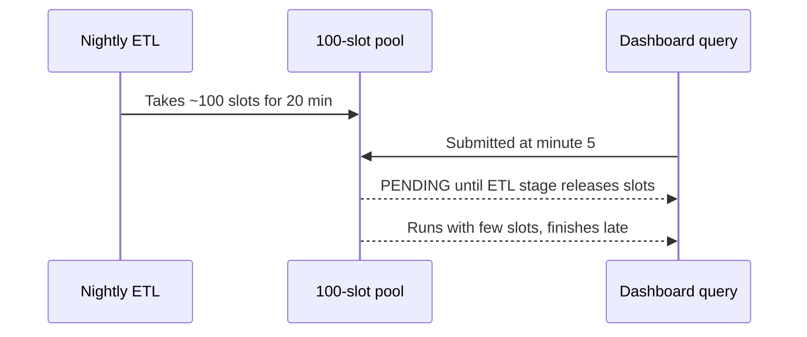

# ⏱️ Explain Me: BigQuery Slots and Slot Contention

> A **BigQuery slot** is a unit of computational capacity. **Slot contention** happens when too many queries compete for the same pool of slots, so jobs wait in a queue and take longer to finish.

---

## 📚 1. Concept in Detail

### What is a slot?

BigQuery does not run a query on one dedicated server. It splits the work into many small tasks and assigns those tasks to **slots**. One slot is roughly the capacity to do a unit of query work (CPU + memory scheduling) at a moment in time.

You pay for slots in two different ways:

| Model | How capacity works | Typical use |
|-------|--------------------|-------------|
| **On-demand** | Shared slot pool. You pay per bytes processed. Fair scheduling with other jobs in the project. | Ad hoc analysis, unpredictable load |
| **Capacity (Editions / reservations)** | You buy a slot commitment or autoscaling max. Your reservation is isolated from other customers. | Steady pipelines, SLAs, predictable cost |

### 🔑 Related concepts

| Concept | Meaning |
|---------|---------|
| **Slot-milliseconds** | How much slot capacity a job actually consumed. `slots × time`. |
| **Reservation** | A named pool of slots assigned to projects or folders. |
| **Assignment** | Links a reservation to a project, folder, or organization, often by job type (`QUERY`, `PIPELINE`, `ML_EXTERNAL`, `BACKGROUND`). |
| **Commitment** | A baseline number of slots you pay for (baseline) even when idle. |
| **Autoscaling** | Extra slots added up to a max when demand spikes, then released. |
| **Fair scheduling** | BigQuery tries to share slots across runnable jobs instead of letting one job take everything. |
| **Slot contention** | Demand for slots exceeds the reservation (or the fair share). Jobs spend time in `PENDING`. |
| **Concurrency** | How many jobs can run at once. High concurrency with a small slot pool means each job gets fewer slots. |
| **Idle slots** | Purchased capacity that no query is using. You still pay for baseline commitments. |

### How a query uses slots



A wide stage (a big scan or shuffle) wants many slots at once. If the pool is busy, that stage waits.

### What slot contention looks like



Contention is a **time** problem, not a **bytes billed** problem. Two runs of the same SQL can scan the same data and still finish in 20 seconds or 4 minutes depending on how many slots they received.

### Signals in job metadata

| Field | What it tells you |
|-------|-------------------|
| `total_slot_ms` | Work done. High value means a heavy query. |
| `timeline` / `pending_ms` | Time spent waiting before or between stages. |
| `total_bytes_processed` | Data scanned. Unchanged by contention. |
| State `PENDING` | Queued for slots or for concurrency limits. |
| `reservation_id` | Which pool served the job. |

Average slots used during a job:

```text
average_slots ≈ total_slot_ms / elapsed_ms
```

If average slots is far below what the query could use, and `pending` time is high, you are looking at contention or a concurrency cap — not a “bad SQL” problem alone.

---

## 🛠️ 2. How to Implement

### Step 1: See which jobs are waiting

Use **Jobs Explorer** (see the Jobs Explorer note) or query `INFORMATION_SCHEMA`:

```sql
SELECT
  job_id,
  user_email,
  statement_type,
  creation_time,
  start_time,
  end_time,
  TIMESTAMP_DIFF(start_time, creation_time, SECOND) AS queue_seconds,
  TIMESTAMP_DIFF(end_time, start_time, SECOND) AS run_seconds,
  total_slot_ms,
  total_bytes_processed,
  reservation_id,
  state,
  error_result.reason
FROM `region-us`.INFORMATION_SCHEMA.JOBS_BY_PROJECT
WHERE creation_time > TIMESTAMP_SUB(CURRENT_TIMESTAMP(), INTERVAL 1 DAY)
  AND job_type = 'QUERY'
ORDER BY queue_seconds DESC
LIMIT 50;
```

`queue_seconds` is creation → start. Large values with a small reservation are the classic contention signature.

### Step 2: Measure slot demand vs capacity

```sql
-- Slot-ms per hour, last 24h
SELECT
  TIMESTAMP_TRUNC(creation_time, HOUR) AS hour,
  SUM(total_slot_ms) / 1000 / 60 / 60 AS slot_hours,
  COUNT(*) AS jobs
FROM `region-us`.INFORMATION_SCHEMA.JOBS_BY_PROJECT
WHERE creation_time > TIMESTAMP_SUB(CURRENT_TIMESTAMP(), INTERVAL 1 DAY)
  AND state = 'DONE'
  AND job_type = 'QUERY'
GROUP BY hour
ORDER BY hour;
```

Compare `slot_hours` in a busy hour to `reservation_slots × 1 hour`. If demand is repeatedly above capacity, jobs will queue.

### Step 3: Create a reservation (Editions)

In the console: **BigQuery → Capacity management → Reservations**.

```bash
# Create a reservation with a baseline and an autoscale max
bq mk --project_id=my-project \
  --location=us \
  --reservation \
  --slots=100 \
  --autoscale_max_slots=400 \
  prod-reservation

# Assign the project’s QUERY jobs to it
bq mk --project_id=my-project \
  --location=us \
  --reservation_assignment \
  --reservation_id=prod-reservation \
  --job_type=QUERY \
  --assignee_type=PROJECT \
  --assignee_id=my-project
```

### Step 4: Separate workloads so they do not fight



Put pipelines and interactive dashboards on **different reservations** (different assignments or projects). A nightly `MERGE` should not starve a dashboard that users are waiting on.

### Step 5: Reduce demand before buying more slots

- Partition and cluster large tables so scans shrink.
- Avoid `SELECT *` in scheduled jobs.
- Materialize heavy intermediates instead of repeating the same join every 5 minutes.
- Cap concurrency on a reservation if a burst of tiny jobs is fragmenting the pool.
- Use `BI Engine` for repeated dashboard aggregates when the pattern fits.

---

## 💡 3. Examples

### Example: Same query, two outcomes

| Run | Bytes processed | Slot-ms | Queue time | Wall time | Interpretation |
|-----|-----------------|---------|------------|-----------|----------------|
| Morning | 40 GB | 1,200,000 | 1 s | 25 s | Plenty of slots (~48 average) |
| 09:05 burst | 40 GB | 1,150,000 | 180 s | 210 s | Similar work, long queue |

The SQL did not get worse. The pool got busy.

### Example: Find the jobs that dominate a slot pool

```sql
SELECT
  user_email,
  SUM(total_slot_ms) / 1000 / 60 AS slot_minutes,
  COUNT(*) AS jobs,
  ROUND(SUM(total_bytes_processed) / POW(1024, 3), 1) AS gb_processed
FROM `region-us`.INFORMATION_SCHEMA.JOBS_BY_PROJECT
WHERE creation_time > TIMESTAMP_SUB(CURRENT_TIMESTAMP(), INTERVAL 6 HOUR)
  AND job_type = 'QUERY'
  AND state = 'DONE'
GROUP BY user_email
ORDER BY slot_minutes DESC
LIMIT 15;
```

### Example: Contention timeline



### Example: Autoscaling choice

| Setting | Effect |
|---------|--------|
| Baseline 50, max 50 | Cheap, queues hard at peak |
| Baseline 50, max 300 | Pays baseline always; autoscale covers spikes |
| Baseline 300, max 300 | Lowest latency, highest idle cost |

---

## ✅ 4. Advantages and Requirements

### Advantages of understanding slots

| Advantage | Why it matters |
|-----------|----------------|
| 🎯 Explains slow queries that scan little data | Queue time is invisible if you only look at bytes |
| 💰 Separates compute cost from scan cost | Editions bill slots; on-demand bills bytes |
| 🧱 Lets you isolate workloads | Reservations stop ETL from blocking BI |
| 📈 Supports capacity planning | Slot-hours per peak tell you what to buy |

### Requirements

- A Google Cloud project with BigQuery enabled.
- Permission to view jobs: `bigquery.jobs.list` / `bigquery.jobs.listAll` (the latter to see other users’ jobs).
- For reservations: `bigquery.reservations.*` and a Capacity / Editions pricing setup in the region.
- Jobs metadata is regional. Query `` `region-us`.INFORMATION_SCHEMA.JOBS_BY_PROJECT `` (or your region), not a single dataset, when you want all jobs.
- `INFORMATION_SCHEMA` job views typically retain a limited history (about 180 days, with shorter windows on some views). Export to a table if you need longer trends.

### Practical rules

- Treat **high `pending` time + stable bytes** as contention.
- Treat **high slot-ms + high bytes** as an expensive query. Fix the SQL or the table layout.
- Do not scale slots to hide a full-table scan that runs every minute.

---

## 🔗 Quick Reference

| Item | Where |
|------|--------|
| Capacity management | BigQuery → Capacity management |
| Job history SQL | ``region-REGION.INFORMATION_SCHEMA.JOBS_BY_PROJECT`` |
| Docs | BigQuery slots and reservations |
