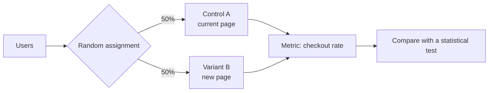
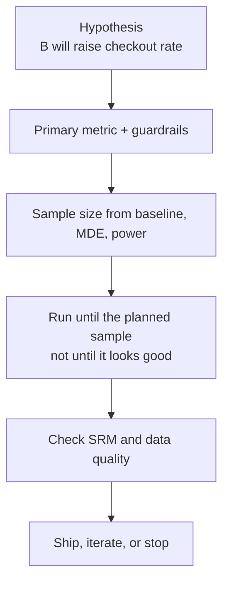
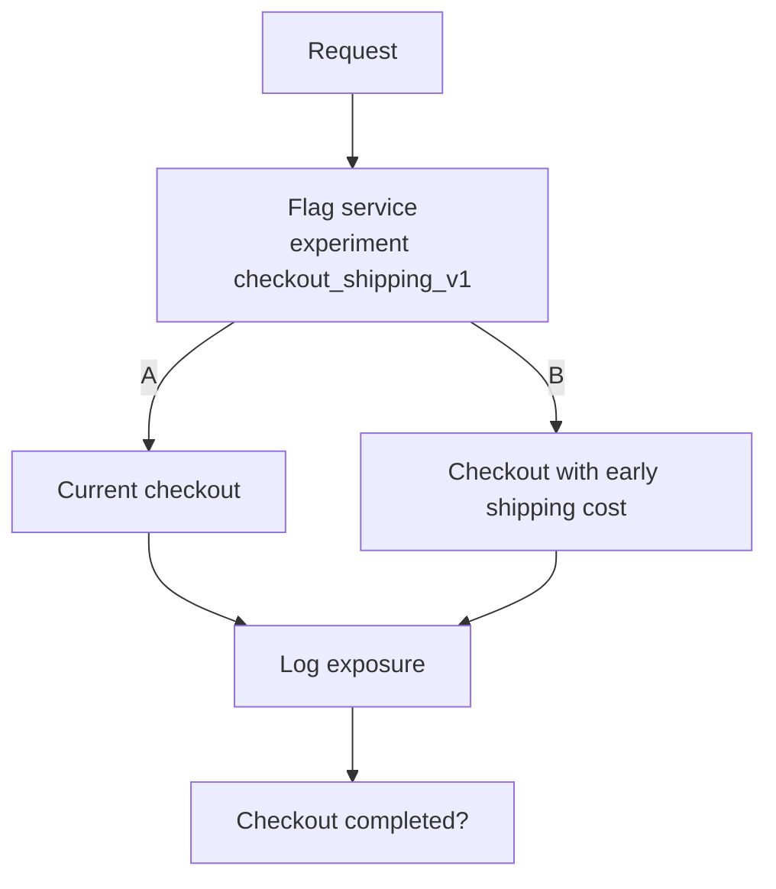

# 🧪 Explain Me: A/B Testing

> **A/B testing** (a controlled experiment) shows two or more variants of a product to different users at the same time, then uses statistics to decide which variant better achieves a goal such as sign-ups, purchases, or time on task.

---

## 📚 1. Concept in Detail

### The idea

You do not debate which button color “should” win. You split traffic, measure a pre-chosen metric, and keep the variant that the data supports. The split must be random so the groups differ mainly by the change you made.



### 🔑 Related concepts

| Concept | Meaning |
|---------|---------|
| **Control** | The current experience (A). |
| **Variant / treatment** | The changed experience (B, sometimes C, D…). |
| **Experiment unit** | Who is randomized: user, account, session, or request. Pick the unit that matches how the change persists. |
| **Primary metric** | The one number that decides the winner. Declare it before the test starts. |
| **Guardrail metric** | A metric that must not get worse (crash rate, latency, revenue per user). |
| **Randomization** | Assignment is by hash of an id, not by who arrived first. |
| **Sample ratio mismatch** | The observed split is not the planned split. Treat that as a broken experiment. |
| **Statistical significance** | The result is unlikely if the two variants were actually equal. A common bar is p < 0.05. |
| **Confidence interval** | A range for the true effect. “+2% to +6%” is more useful than a single p-value. |
| **Power** | The chance you detect a real effect of a size you care about. Often aimed at 80%. |
| **Minimum detectable effect (MDE)** | The smallest lift worth running the test to find. |
| **Novelty effect** | Users click a new thing because it is new. The lift fades. |
| **Interference** | One user’s treatment changes another user’s outcome (marketplaces, social feeds). |

### What a valid test needs



Peeking every hour and stopping when p drops below 0.05 inflates false winners. Decide the sample size first, or use a method that is designed for continuous peeking (sequential tests).

### Related experiment types

| Type | Difference from a basic A/B test |
|------|----------------------------------|
| **A/B/n** | More than one variant against a control |
| **Multivariate** | Several changes combined (headline × image). Needs much more traffic |
| **Holdout** | A small group stays on the old version after launch, to measure long-term effect |
| **Switchback** | Whole time windows alternate variants, used when users interfere with each other |

---

## 🛠️ 2. How to Implement

### Step 1: Write the hypothesis

> If we show shipping cost before the payment step, checkout completion will rise, because surprise cost is a common drop-off. Primary metric: checkout completion rate. Guardrail: revenue per visitor must not fall.

### Step 2: Assign users stably

The same user must see the same variant on every visit. Hash an id; do not use `random()` per request.

```python
import hashlib

def variant(user_id: str, experiment: str, split: float = 0.5) -> str:
    digest = hashlib.sha256(f"{experiment}:{user_id}".encode()).hexdigest()
    bucket = int(digest[:8], 16) / 0xFFFFFFFF
    return "B" if bucket < split else "A"
```

Use a logged-in user id when you have one. For anonymous traffic, use a first-party cookie id and accept that cleared cookies reshuffle people.

### Step 3: Log exposure and outcomes

```python
# Call this when the user actually sees the variant, not when you compute it
log_event("experiment_exposure", {
    "experiment": "checkout_shipping_v1",
    "user_id": user_id,
    "variant": variant_name,
})

# Later, the business event
log_event("checkout_completed", {"user_id": user_id, "order_id": order_id})
```

Exposure logging prevents dilution: people who never saw the page should not sit in the denominator.

### Step 4: Size the test

Inputs:

- Baseline conversion `p` (for example 8%).
- MDE you care about (for example +0.5 percentage points, or a 5% relative lift).
- Significance level α (0.05) and power (0.80).

A rough two-proportion sample size per variant:

```python
import math

def sample_size_per_variant(p: float, mde_abs: float, alpha=0.05, power=0.80) -> int:
    # Normal approximations: z_alpha/2 ≈ 1.96, z_power ≈ 0.84
    z_a, z_b = 1.96, 0.84
    p2 = p + mde_abs
    pooled = (p + p2) / 2
    n = (z_a * math.sqrt(2 * pooled * (1 - pooled)) + z_b * math.sqrt(p * (1 - p) + p2 * (1 - p2))) ** 2
    return math.ceil(n / mde_abs ** 2)

print(sample_size_per_variant(0.08, 0.005))
```

This is a planning estimate. Use a power calculator or your experimentation platform for the number you commit to.

### Step 5: Analyze

```python
from math import sqrt

def two_proportion_z(x1, n1, x2, n2):
    p1, p2 = x1 / n1, x2 / n2
    p = (x1 + x2) / (n1 + n2)
    se = sqrt(p * (1 - p) * (1 / n1 + 1 / n2))
    z = (p2 - p1) / se
    # lift of B over A
    return {"rate_a": p1, "rate_b": p2, "abs_lift": p2 - p1, "z": z}

print(two_proportion_z(x1=800, n1=10000, x2=860, n2=10000))
```

Also check the split:

```text
SRM: expected 50/50, observed 10,000 vs 10,400 → investigate before trusting the lift
```

A chi-square test on assignment counts catches sample ratio mismatch.

### Feature-flag shape



Tools that do this product-side include LaunchDarkly, GrowthBook, Statsig, Optimizely, and home-grown flag services. The statistics do not change when the vendor does.

---

## 💡 3. Examples

### Example: Checkout copy

| | Control A | Variant B |
|--|-----------|-----------|
| Users exposed | 20,000 | 20,100 |
| Checkouts | 1,600 (8.0%) | 1,728 (8.6%) |
| Absolute lift | | +0.6 pp |
| Guardrail: refund rate | 1.1% | 1.0% |

If the interval for the lift sits above zero and the guardrail holds, ship B. If latency on B jumped, do not ship on conversion alone.

### Example: A test you should not trust

- Started Monday, stopped Wednesday because B was “winning.”
- Primary metric was changed after looking at results.
- Mobile and desktop were mixed, but the bug only hit mobile Safari.
- 80% of traffic landed in A because the hash used a timestamp.

Any one of these can manufacture a winner.

### Example: Decision table

| Result | Action |
|--------|--------|
| Lift positive, guardrails fine, SRM fine | Ship B |
| Lift flat, enough sample | Keep A; the change did not matter |
| Lift positive, crash rate up | Do not ship; fix quality first |
| SRM failed | Discard the readout; fix assignment |
| Underpowered | Keep running or accept you cannot see a small effect |

---

## ✅ 4. Advantages and Requirements

### Advantages

| Advantage | Detail |
|-----------|--------|
| 🎯 Decides with evidence | Replaces opinion with a measured effect on a real metric |
| 🛡️ Limits blast radius | A bad idea reaches only part of traffic |
| 📊 Quantifies the gain | You learn the size of the lift, not only the direction |
| 🔁 Builds a record | Past experiments stop the team from retesting the same myth |

### Requirements

- A single primary metric chosen in advance, plus guardrails.
- Enough traffic for the MDE you care about. Small sites often cannot detect a 1% relative lift.
- Stable assignment (hash of user or cookie id) and exposure logs.
- Randomization that is independent of the outcome.
- A runtime long enough to cover weekly seasonality (often at least one full week).
- An analysis that matches the unit of randomization. If you randomize users, do not treat each click as an independent sample.
- Permission to experiment on users, and a way to turn the variant off quickly.

### Common mistakes

- Shipping the variant that wins on a secondary metric after the primary was flat.
- Comparing A and B when B also shipped a performance regression.
- Calling a result significant because the dashboard refreshed at a lucky hour.

---

## 🔗 Quick Reference

| Term | One line |
|------|----------|
| A | Control |
| B | Treatment |
| p-value | Evidence against “no difference” |
| Power | Chance to detect a real effect of the size you set |
| SRM | Actual split ≠ planned split |
