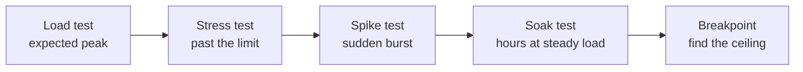
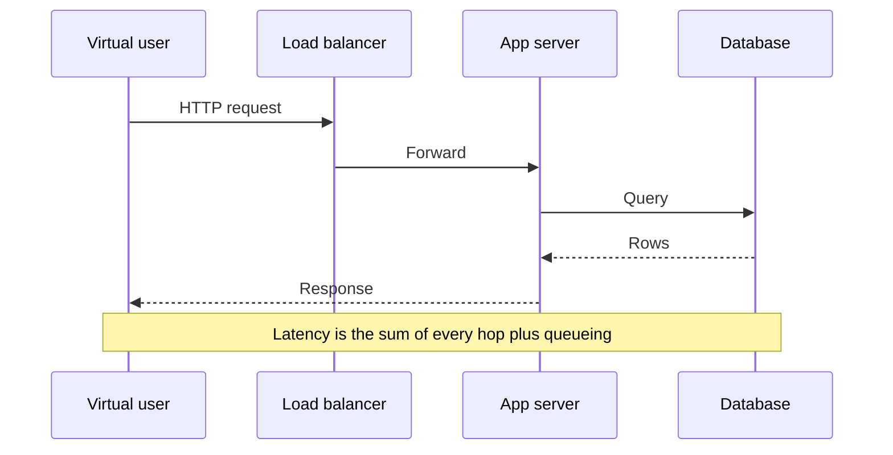
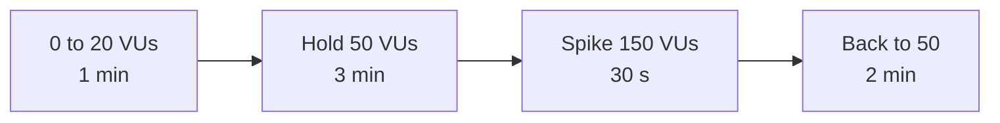

# 📈 Explain Me: Application Load Testing

> **Load testing** sends a controlled amount of traffic to an application to measure how it behaves under expected — and heavier than expected — use. The goal is to find latency, errors, and resource limits before users do.

---

## 📚 1. Concept in Detail

### What you are measuring

A load test is an experiment. You define a workload (who calls which endpoints, how often), run it against a realistic environment, and record how the system responds.

| Metric | What it means |
|--------|----------------|
| **Throughput** | Successful requests per second (RPS) or transactions per second |
| **Latency** | Time to response. Report p50, p95, and p99, not only the average |
| **Error rate** | Share of responses that are 5xx, timeouts, or failed assertions |
| **Saturation** | CPU, memory, DB connections, thread pools, queue depth at peak |
| **Scalability** | How throughput and latency change when you add instances |

Average latency hides pain. A p50 of 80 ms with a p99 of 8 s means one in a hundred users is stuck.

### Related test types



| Type | Question it answers |
|------|---------------------|
| **Load** | Can we hold the traffic we expect on a busy day? |
| **Stress** | What breaks first when traffic exceeds capacity? |
| **Spike** | Does a sudden jump (a sale, a push notification) knock us over? |
| **Soak / endurance** | Do memory leaks or connection leaks show up after hours? |
| **Breakpoint** | At what RPS do errors or latency SLOs fail? |

### Important concepts

| Concept | Meaning |
|---------|---------|
| **Virtual user (VU)** | A simulated client that runs a scripted journey |
| **Ramp-up** | Gradual increase in VUs so you do not create a fake thundering herd |
| **Think time** | Pause between a user’s actions. Without it, the test is harsher than reality |
| **Scenario** | A mix of journeys (browse, search, checkout) with weights |
| **SLA / SLO** | The pass bar, for example p95 under 300 ms and error rate under 1% |
| **Test environment** | Should match production in topology. A tiny staging DB will lie |
| **Bottleneck** | The first saturated resource: app CPU, DB, cache, lock, or network |

### Where time goes



---

## 🛠️ 2. How to Implement

### Plan before you generate traffic

1. Pick 3–5 critical journeys (login, search, checkout), not every endpoint.
2. Get production ratios: for example 70% reads, 25% search, 5% writes.
3. Set a target: expected peak RPS and the SLO.
4. Test an environment you are allowed to stress. Never point a tool at production without an explicit window and a kill switch.
5. Watch the server side (CPU, DB connections, error logs) at the same time as the client side.

### k6 (scriptable load test)

```bash
# https://grafana.com/docs/k6/latest/set-up/install-k6/
k6 run loadtest.js
```

```javascript
import http from "k6/http";
import { check, sleep } from "k6";

export const options = {
  stages: [
    { duration: "1m", target: 20 },  // ramp up
    { duration: "3m", target: 50 },  // hold expected load
    { duration: "1m", target: 0 },   // ramp down
  ],
  thresholds: {
    http_req_failed: ["rate<0.01"],
    http_req_duration: ["p(95)<300"],
  },
};

export default function () {
  const res = http.get("https://staging.example.com/api/items");
  check(res, {
    "status is 200": (r) => r.status === 200,
    "body has items": (r) => r.json("items") !== undefined,
  });
  sleep(1); // think time
}
```

k6 fails the process exit code when a threshold breaks, so the same script can run in CI.

### A write journey with a unique user

```javascript
import http from "k6/http";
import { check } from "k6";

export default function () {
  const payload = JSON.stringify({
    email: `user-${__VU}-${__ITER}@example.com`,
    name: "Load Test",
  });
  const res = http.post("https://staging.example.com/api/users", payload, {
    headers: { "Content-Type": "application/json" },
  });
  check(res, { "created": (r) => r.status === 201 });
}
```

`__VU` and `__ITER` keep rows unique so the test does not fail on duplicate-key conflicts.

### Locust (Python)

```python
from locust import HttpUser, task, between

class Shopper(HttpUser):
    wait_time = between(1, 3)

    @task(3)
    def browse(self):
        self.client.get("/api/items")

    @task(1)
    def checkout(self):
        self.client.post("/api/orders", json={"sku": "A1", "qty": 1})
```

```bash
locust -f locustfile.py --headless -u 100 -r 10 -t 5m --host https://staging.example.com
```

`-u` is users, `-r` is spawn rate per second, `-t` is duration.

### What to record on the server

| Signal | Tooling examples |
|--------|------------------|
| RPS, latency, errors | k6 summary, APM (Cloud Monitoring, Datadog) |
| CPU and memory | Instance metrics |
| DB connections and slow queries | Database dashboard |
| Saturation | Thread pool queue, pub/sub backlog |

---

## 💡 3. Examples

### Example: Reading a result

| Metric | Result | Verdict |
|--------|--------|---------|
| Peak RPS | 420 | Above the 300 RPS target |
| p95 latency | 280 ms | Inside the 300 ms SLO |
| p99 latency | 2.4 s | Tail is unhealthy |
| Error rate | 0.2% | Acceptable |
| DB connections | pegged at pool max | Likely bottleneck |

The test “passed” average throughput and still showed a connection-pool ceiling. The next change is pool size or fewer queries per request — then a retest.

### Example: Ramp profile



The spike stage answers a different question from the hold stage. Keep them in one report so you can see recovery time after the burst.

### Example: CI gate

```yaml
# GitHub Actions sketch
- name: Load test staging
  run: k6 run --out json=results.json loadtest.js
```

Run a short smoke load on every release candidate. Run the full soak on a schedule, not on every commit — soaks are slow and they dirty data.

---

## ✅ 4. Advantages and Requirements

### Advantages

| Advantage | Detail |
|-----------|--------|
| 🔍 Finds limits early | You learn the breakpoint with a script, not during a launch |
| 📏 Protects SLOs | Thresholds turn a feeling of “it’s slow” into a pass or fail |
| 🔁 Repeatable | The same script compares this release with the last one |
| 💸 Cheaper than an outage | A staging test costs compute time; a failed launch costs users |

### Requirements

- A target environment you are allowed to load, with production-like CPU, DB, and cache.
- A workload model based on real traffic shares, not one endpoint hammered in a loop.
- Isolated test data and a cleanup step. Load tests should not email real customers or charge real cards.
- Server-side metrics during the run. Client latency alone cannot name the bottleneck.
- A success bar written down before the test (p95, error rate, RPS).
- Tools: k6, Locust, JMeter, or Gatling. k6 and Locust are enough for most HTTP APIs.
- Network headroom on the load generator. If the generator saturates, you measured your laptop, not the app.

### Good practice

- Ramp up. A step from 0 to 1,000 VUs in one second tests your autoscaler’s reaction, which is a spike test — label it as one.
- Assert response bodies, not only status codes. A 200 with an error payload is a failure.
- Stop the test when error rate climbs. More load after the breakpoint mostly adds noise.

---

## 🔗 Quick Reference

| Tool | Style |
|------|--------|
| k6 | JavaScript scenarios, CLI, thresholds |
| Locust | Python, web UI or headless |
| JMeter | GUI plans, heavy XML |
| Gatling | Scala/Java, strong reports |
