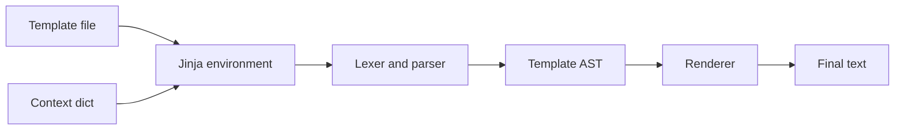
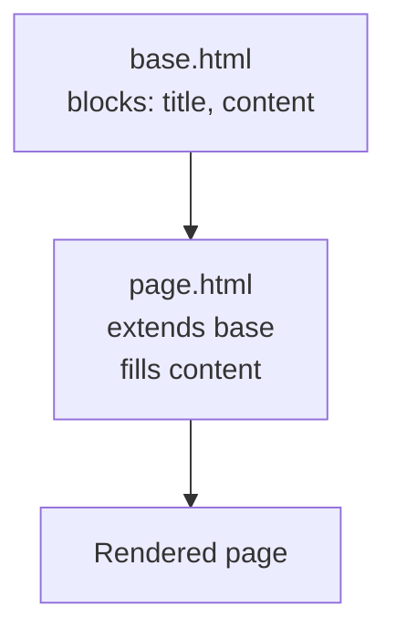

# 🧩 Explain Me: Jinja

> **Jinja** is a templating language for Python. You write a file with placeholders and control tags, and Jinja renders it into text — HTML, SQL, YAML, or emails — using data you pass in.

---

## 📚 1. Concept in Detail

### What problem it solves

Application code and content change for different reasons. Jinja keeps the **shape** of a document in a template and the **values** in Python (or in a tool like dbt or Ansible). The same SQL file can run for yesterday or for a backfill without copy-paste.

### 🔑 Syntax building blocks

| Piece | Syntax | Role |
|-------|--------|------|
| Expression | `{{ user.name }}` | Print a value |
| Statement | ` … ` | Control flow |
| Comment | `{# ignore me #}` | Not rendered |
| Filter | `{{ name \| upper }}` | Transform a value |
| Test | `` | Check a condition |
| Macro | `` | Reusable snippet |
| Include | `` | Pull in another template |
| Inheritance | `` | Child fills blocks in a parent |
| Block | `` | Overridable section |
| Whitespace control | `` | Strip nearby spaces and newlines |

### How rendering works



Jinja compiles a template once and can render it many times with different contexts. Undefined variables can be silent, strict, or chained with defaults — you choose the policy on the environment.

### Important related ideas

| Idea | Why it matters |
|------|----------------|
| **Context** | The dictionary of variables visible inside the template. |
| **Autoescape** | HTML templates should escape `<` and `&` so user text cannot inject script. SQL templates usually turn this off and must not concatenate raw user input. |
| **Sandbox** | Restricts attribute access when templates come from untrusted authors. |
| **Loader** | Where templates live: filesystem, a dict, or a package. |
| **StrictUndefined** | Fails the render if a variable is missing. Safer for SQL and config. |
| **dbt / Ansible / Flask** | Popular tools that embed Jinja. The language is the same; the variables they inject differ. |

### Inheritance



The child says ``. Only the blocks it overrides change. Navigation and layout stay in one parent file.

---

## 🛠️ 2. How to Implement

### Install

```bash
pip install Jinja2
```

### Render a string

```python
from jinja2 import Environment, StrictUndefined

env = Environment(undefined=StrictUndefined, autoescape=False)
template = env.from_string("""
SELECT
  user_id,
  country
FROM `{{ project }}.{{ dataset }}.events`
WHERE event_date = '{{ run_date }}'

  AND country IN (
    
      '{{ c }}', 
    
  )

""".strip())

sql = template.render(
    project="acme",
    dataset="analytics",
    run_date="2026-10-30",
    countries=["US", "IN"],
)
print(sql)
```

### Load templates from a folder

```python
from jinja2 import Environment, FileSystemLoader, StrictUndefined, select_autoescape

env = Environment(
    loader=FileSystemLoader("templates"),
    undefined=StrictUndefined,
    autoescape=select_autoescape(["html", "xml"]),
    trim_blocks=True,
    lstrip_blocks=True,
)

html = env.get_template("report.html").render(
    title="Daily sales",
    rows=[{"sku": "A1", "amount": 1200}, {"sku": "B2", "amount": 800}],
)
```

`trim_blocks` and `lstrip_blocks` remove the blank lines that `` tags otherwise leave behind. That matters for SQL and YAML.

### A custom filter

```python
def inr(value: float) -> str:
    return f"₹{value:,.2f}"

env.filters["inr"] = inr
# {{ total | inr }}  →  ₹1,250.00
```

### Macros and includes

```jinja
{# templates/macros.sql #}

{{ column }} BETWEEN '{{ start_date }}' AND '{{ end_date }}'

```

```jinja

SELECT * FROM events
WHERE {{ m.partition_filter("event_date", start_date, end_date) }}
```

---

## 💡 3. Examples

### Example: HTML with inheritance

`base.html`

```html
<!DOCTYPE html>
<html>
  <head><title>App</title></head>
  <body>
    <nav>Home · Reports</nav>
    <main></main>
  </body>
</html>
```

`report.html`

```html

Daily sales

  <h1>{{ title }}</h1>
  <ul>
  
    <li>{{ row.sku }} — {{ row.amount | inr }}</li>
  
    <li>No rows.</li>
  
  </ul>

```

The `` on a `for` runs when the list is empty.

### Example: dbt model

```sql
{{ config(materialized="incremental") }}

SELECT
  event_date,
  user_id,
  COUNT(*) AS events
FROM {{ source("analytics", "events") }}

WHERE event_date > (SELECT MAX(event_date) FROM {{ this }})

GROUP BY 1, 2
```

dbt renders this Jinja before BigQuery sees it. `{{ this }}` is the model’s own relation.

### Example: Safe vs unsafe SQL

```python
# Unsafe: user text dropped straight into SQL
template = env.from_string("SELECT * FROM t WHERE name = '{{ name }}'")

# Safer: template only chooses structure; values go through query parameters
template = env.from_string("SELECT * FROM t WHERE name = @name")
```

Jinja does not parameterize SQL. If a value comes from a user, bind it with the database driver. Use Jinja for identifiers, dates you control, and optional clauses.

### Filters you will use often

| Filter | Example | Result |
|--------|---------|--------|
| `default` | `{{ region \| default("US") }}` | `US` if missing |
| `upper` / `lower` | `{{ "Ab" \| lower }}` | `ab` |
| `join` | `{{ ids \| join(", ") }}` | `1, 2, 3` |
| `tojson` | `{{ row \| tojson }}` | JSON text |
| `length` | `{{ items \| length }}` | count |

---

## ✅ 4. Advantages and Requirements

### Advantages

| Advantage | Detail |
|-----------|--------|
| 📄 Readable templates | Designers and analysts can edit structure without reading Python |
| 🔁 One template, many runs | Dates, projects, and optional filters stay as variables |
| 🧱 Reuse | Macros, includes, and inheritance remove copy-paste |
| 🔌 Embedded everywhere | Flask, FastAPI, dbt, Ansible, Cookiecutter, Airflow |
| 🛡️ Autoescape | HTML escaping is on when you ask for it |

### Requirements

- Python 3.8+ and `pip install Jinja2`.
- A loader (files or strings) and an explicit context.
- `StrictUndefined` for generated SQL and config so a typo fails the job.
- `autoescape` enabled for HTML; disabled only for formats where escaping would corrupt output.
- A rule that untrusted input is never interpolated into SQL, shell, or HTML without escaping or binding.
- For dbt: a dbt project (`dbt_project.yml`) and Jinja written inside `.sql` models.

### Limits

Jinja is a templating language, not a programming language you should put business logic into. Heavy calculations belong in Python or SQL. Templates that branch on ten conditions become harder to test than plain code.

---

## 🔗 Quick Reference

| Item | Value |
|------|--------|
| Package | `Jinja2` |
| Docs | https://jinja.palletsprojects.com |
| Print | `{{ expr }}` |
| Logic | `` |
| Comment | `{# ... #}` |
